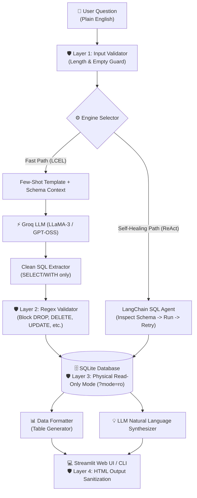

# 🧠 Secure Text-to-SQL AI Assistant

> **Turn natural language questions into secure, production-grade SQL queries with automated data synthesis — powered by Groq, LangChain, and SQLite.**

[](https://www.python.org/)
[](https://www.langchain.com/)
[](https://groq.com/)
[](https://streamlit.io/)
[](#-security--defense-in-depth)

---

## 📌 Problem & Why This Matters

In most organizations, business teams (Product, Sales, HR, Finance) need data to make daily decisions:
- *"Who are our top 3 salespeople this quarter?"*
- *"Which projects are currently past their deadline?"*
- *"What is our average salary expenditure by department?"*

**The Bottleneck:** Non-technical team members cannot write SQL, and busy data engineering teams face constant backlogs answering repetitive ad-hoc query requests.

**The Solution:** This assistant acts as an autonomous **AI Data Analyst**. Users ask questions in plain English, and the system dynamically generates valid SQL, safely runs it against the database, and returns both formatted tabular data and an executive English summary — in under a second.

---

## ⚡ Highlights & Key Features

- **⚡ Dual Engine Architecture:**
  - **`Chain Mode` (LCEL):** Ultra-fast, single-hop deterministic query generation with custom prompt orchestration.
  - **`Agent Mode` (ReAct):** Multi-hop reasoning agent that can introspect schema, catch SQL execution errors, and self-correct dynamically.
- **🛡️ 5-Layer Defense-in-Depth Security:** Built with strict production guardrails preventing prompt injection, destructive SQL commands, and database corruption.
- **📊 Interactive Streamlit Dashboard & Terminal CLI:** Rich UI with custom CSS, execution badges, dynamic schema viewer, and conversation history.
- **🧪 Built-In Evaluation Suite (`evaluate.py`):** Automated test harness validating query accuracy and latency across 10 canonical business scenarios.

---

## 🏗️ System Architecture & Data Flow



---

## ⚙️ Engine Modes Explained: Chain vs. Agent

This project implements two distinct LLM reasoning patterns, selectable directly from the UI or CLI:

| Feature | ⚡ Chain Mode (`chain`) | 🤖 Agent Mode (`agent`) |
| :--- | :--- | :--- |
| **Paradigm** | **LangChain Expression Language (LCEL)** | **ReAct Loop (Reason + Act)** |
| **Execution** | Deterministic, single pass | Multi-step reasoning loop |
| **Latency** | **Sub-second (~0.8s - 1.2s)** | Slower (~2.5s - 5.0s) |
| **Error Handling** | Validates and reports immediately | **Self-healing:** Reads DB error messages, re-checks schema, and corrects query |
| **Best For** | Production dashboards, predictable costs, high throughput | Complex multi-table exploration and ambiguous questions |

---

## 🛡️ Security & Defense-in-Depth

Most naive Text-to-SQL projects execute raw LLM output directly on the database. This project implements a **5-layer security model** to safeguard system integrity:

1. **Input Boundary Guard (Layer 1):** Rejects empty strings and enforces a strict 500-character ceiling to prevent prompt-bloating and denial-of-wallet attacks.
2. **Structural Read-Only Parser (Layer 2):** Regex parser only extracts statements beginning with `SELECT` or `WITH`.
3. **Word-Boundary Regex Filter (Layer 3):** Inspects the full SQL payload using `\b` word boundaries for destructive keywords (`DROP`, `DELETE`, `UPDATE`, `INSERT`, `ALTER`, `CREATE`, `TRUNCATE`, `ATTACH`, `DETACH`), preventing whitespace/tab bypasses (`DROP\tTABLE`).
4. **OS-Level Read-Only Connection (Layer 4):** Database connections use SQLite's URI mode:
   ```python
   sqlite3.connect(f"file:{db_path}?mode=ro", uri=True)
   ```
   *Even if an attacker circumvents every application check, the operating system and SQLite engine strictly deny write permissions.*
5. **Output XSS Sanitization (Layer 5):** All dynamic LLM responses rendered in Streamlit are escaped using `html.escape()`, preventing stored script injection.
6. **Resource Safety:** All database connections are wrapped in Python context managers (`with sqlite3.connect(...)`) to prevent file lock leaks.

---

## 🗃️ Database Schema

The sample database represents a modern technology enterprise with interconnected relational tables:

```
┌─────────────────┐       ┌─────────────────┐
│   departments   │       │    employees    │
├─────────────────┤       ├─────────────────┤
│ dept_id (PK)    │◄──┐   │ emp_id (PK)     │
│ name            │   └───┼ dept_id (FK)    │
│ location        │       │ name, email     │
│ budget, manager │       │ role, salary    │
└─────────────────┘       │ hire_date       │
                          │ is_active       │
                          └────────┬────────┘
                                   │
         ┌─────────────────────────┼─────────────────────────┐
         ▼                                                   ▼
┌─────────────────┐                                 ┌─────────────────┐
│    projects     │                                 │      sales      │
├─────────────────┤                                 ├─────────────────┤
│ project_id (PK) │                                 │ sale_id (PK)    │
│ lead_emp_id(FK) │                                 │ emp_id (FK)     │
│ dept_id (FK)    │                                 │ amount          │
│ name, budget    │                                 │ sale_date       │
│ status, deadline│                                 │ product, region │
└─────────────────┘                                 └─────────────────┘
```

---

## 🚀 Quickstart & Setup

### 1. Clone & Set Up Environment

```bash
git clone https://github.com/your-username/text-to-sql.git
cd text_to_sql
```

Create and activate a virtual environment:

```bash
# Windows
python -m venv .venv
.venv\Scripts\activate

# macOS / Linux
python3 -m venv .venv
source .venv/bin/activate
```

Install dependencies:

```bash
pip install -r requirements.txt
```

### 2. Configure Environment Variables

Copy the provided template and add your free Groq API key:

```bash
cp .env.example .env
```

Open `.env` and fill in:
```ini
GROQ_API_KEY=gsk_your_actual_key_here
GROQ_MODEL=openai/gpt-oss-120b
DB_PATH=db/company.db
DEBUG=false
```
*(Get a free API key at [console.groq.com](https://console.groq.com/))*

### 3. Initialize & Seed Database

Create the SQLite database with 4 populated tables:

```bash
python setup_db.py
```

---

## 🎮 How to Run

### Option A: Interactive Web UI (Streamlit)
```bash
streamlit run app.py
```
Open [http://localhost:8501](http://localhost:8501) in your browser to ask questions, view generated SQL, toggle tables, and inspect schema.

### Option B: Terminal CLI
```bash
python cli.py
```
Includes interactive commands:
- `:schema` — Print live database schema
- `:history` — Review past session queries and answers
- `:help` — List sample queries
- `:clear` — Reset session history

### Option C: Python Library Usage
```python
from text_to_sql import TextToSQL

assistant = TextToSQL(mode="chain")
result = assistant.query("Which department has the highest total payroll?")

print("SQL:", result["sql"])
print("Answer:", result["answer"])
```

---

## 🧪 Evaluation & Accuracy Benchmark

A reliable AI system must be measurable. Run the automated evaluation suite:

```bash
python evaluate.py
```

### Benchmark Metrics:
- **Test Suite:** 10 diverse queries (Multi-table `JOIN`, `GROUP BY`, `ORDER BY + LIMIT`, Date comparisons, and aggregations).
- **Target Accuracy:** **90%+ execution pass rate**.
- **Latency Monitoring:** Measures end-to-end response time per query to ensure interactive performance.

---

## 📁 Repository Structure

```
text_to_sql/
├── app.py              # Streamlit Web Application (Frontend)
├── cli.py              # Interactive Terminal Interface
├── text_to_sql.py      # Core NLP-to-SQL Orchestrator (Chain & Agent)
├── setup_db.py         # Database Seeding & Schema Generator
├── prompts.py          # Few-shot prompts, instructions & answer templates
├── utils.py            # Security validators, read-only DB connector & formatting
├── evaluate.py         # Automated test & benchmark suite
├── requirements.txt    # Project dependencies
├── .env.example        # Sanitized environment template
├── .gitignore          # Git exclusion rules (protects keys & local DB)
└── README.md           # Engineering documentation
```

---
